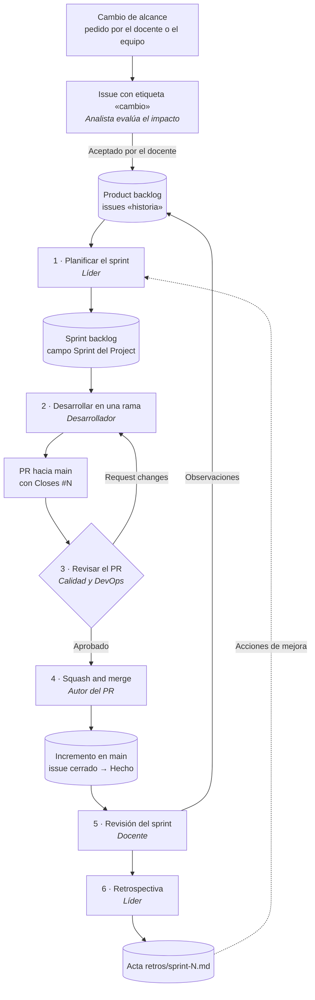
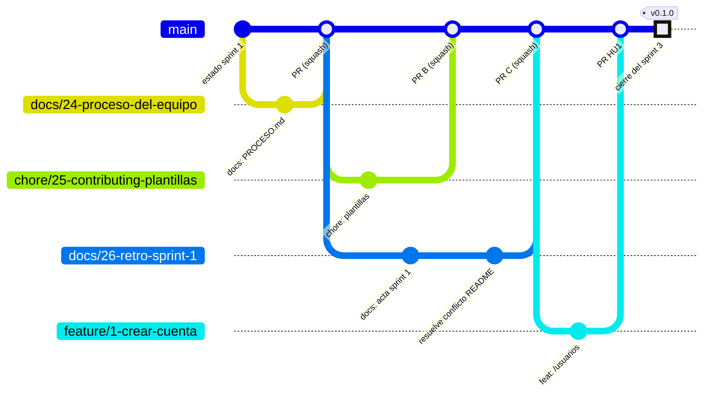

# Proceso del equipo Voz Gasto

Este documento describe cómo trabaja el equipo: metodología, roles, artefactos y flujo de ramas. Solo se cambia mediante un pull request revisado. Las reglas del día a día están resumidas en [CONTRIBUTING.md](../../CONTRIBUTING.md).

- **Equipo:** Antonio Revilla, Carlos Granda y Carlos Hernández
- **Docente, product owner y cliente:** Ing. Nancy Betancourt
- **Duración:** 16 semanas, 8 sprints de 2 semanas

---

## A. Metodología y flujo del proceso

### A.1 Metodología elegida

En la matriz de decisión del Taller 1 elegimos el **modelo incremental**, con 8 iteraciones de 2 semanas que llamamos sprints. Nos conviene por cuatro razones:

1. Los tres incrementos coinciden con los hitos del curso: v0.1.0 en la semana 6, v1.0.0 en la semana 11 y v1.1.0 en la semana 16.
2. El núcleo (ingresos, gastos y presupuesto) es estable y se puede planificar por adelantado.
3. El módulo de voz y la interfaz cambiarán tras el prototipo y el piloto. Los sprints cortos, con revisión al cierre, nos dejan absorber esos cambios.
4. Con tres integrantes no hace falta una ceremonia más pesada. Cada evento deja su evidencia en GitHub.

### A.2 Proceso de un sprint

| N.º | Actividad | Entrada | Salida | Responsable |
|---|---|---|---|---|
| 1 | Planificar el sprint | Backlog priorizado, acciones de la retrospectiva anterior | Objetivo del sprint en el README e issues con el campo Sprint | Líder |
| 2 | Desarrollar en una rama | Issue en Por hacer, asignado | Rama `tipo/N-descripcion`, commits y PR abierto | Desarrollador |
| 3 | Revisar el PR | PR abierto con la plantilla completa | Comentarios, cambios solicitados o aprobación | Calidad y DevOps |
| 4 | Integrar | PR aprobado y conversaciones resueltas | Un commit en `main`, rama borrada, issue en Hecho | Autor del PR |
| 5 | Revisar el sprint | Incremento en `main` | Aceptación u observaciones del docente, que vuelven al backlog | Docente |
| 6 | Retrospectiva | Tablero, cumplimiento del sprint, experiencia del equipo | `docs/proceso/retros/sprint-N.md` con 2 o 3 acciones | Líder |
| — | Cambio de alcance | Pedido del docente o hallazgo del equipo | Issue con etiqueta `cambio`, aceptado o rechazado por el docente | Analista |

Un cambio de alcance nunca entra directo al sprint en curso. El Analista abre un issue con la etiqueta `cambio` y anota qué historias, riesgos y fechas afecta. Si el docente lo acepta, entra al backlog y se prioriza en la siguiente planificación. Si obliga a sacar algo del sprint, se baja primero lo Could y luego lo Should.

### A.3 Eventos

| Evento | Cuándo | Duración | Participantes | Evidencia en GitHub |
|---|---|---|---|---|
| Planificación del sprint | Primer día de cada sprint | 45 min | Equipo | Objetivo en el README e issues con Sprint y responsable en el Project |
| Seguimiento | Tres veces por semana | 15 min | Equipo | Tablero al día; issues trabados con la etiqueta `bloqueado` y un comentario |
| Revisión semanal | En clase, cada semana | 10 min | Equipo y docente | Comentarios del docente en los issues o un issue `cambio` |
| Revisión del sprint | Último día del sprint | 15 min | Equipo y docente | Incremento en `main`; observaciones registradas como issues |
| Retrospectiva | Después de la revisión | 30 min | Equipo | `docs/proceso/retros/sprint-N.md` |
| Entrega de versión | Semanas 6, 11 y 16 | — | Calidad y DevOps | Etiqueta `vX.Y.Z` en `main` |

### A.4 Relación con los hitos del curso

| Sprint | Semanas | Objetivo | Hito |
|---|---|---|---|
| 1 | 1–2 | Proceso, repositorio y documentación base | — |
| 2 | 3–4 | Entorno, acceso de usuarios, ingresos y prototipo de voz | — |
| 3 | 5–6 | Núcleo manual con pruebas | **v0.1.0** (semana 6) |
| 4 | 7–8 | Registro por voz preliminar | — |
| 5 | 9–10 | Presupuesto, saldo y alertas | — |
| 6 | 11–12 | Estabilizar y entregar | **v1.0.0** (semana 11) |
| 7 | 13–14 | Reportes y piloto con 10 usuarios | — |
| 8 | 15–16 | Mejoras y cierre | **v1.1.0** (semana 16) |

El detalle de cada sprint está en el plan de la Tarea 2 ([docs/02-requerimientos/](../02-requerimientos/)). Los ajustes al plan se registran como issues con la etiqueta `cambio`.

---

## B. Roles y responsabilidades

### B.1 Roles

Los tres integrantes son desarrolladores en todos los sprints. Además, cada uno cumple un rol del proceso, que rota en cada sprint. Las áreas técnicas no rotan: Antonio Revilla lleva el backend, Carlos Hernández la app móvil y Carlos Granda la voz, el PLN y las pruebas.

| Rol | Quién | Responsabilidades en Voz Gasto |
|---|---|---|
| Docente (product owner y cliente) | Ing. Nancy Betancourt | Prioriza el backlog, acepta o rechaza cada incremento y aprueba los cambios de alcance |
| Líder | Rota | Planifica el sprint, mantiene el tablero al día, conduce el seguimiento y la retrospectiva, y escribe el acta |
| Analista | Rota | Redacta las historias y sus criterios de aceptación, refina el backlog, evalúa los cambios de alcance y mantiene `docs/` coherente |
| Calidad y DevOps | Rota | Revisa los PR, vigila la definición de terminado, mantiene la protección de `main` y la CI, y crea las etiquetas de versión |
| Desarrollador | Todos | Toma issues, trabaja en una rama por issue, abre el PR y lo fusiona cuando está aprobado |

### B.2 Matriz RACI

R: lo hace · A: aprueba o rinde cuentas (una sola por fila) · C: se le consulta · I: se le informa

| Actividad | Docente | Líder | Analista | Calidad y DevOps | Desarrollador |
|---|---|---|---|---|---|
| Priorizar el backlog | A | C | R | I | I |
| Redactar issues y criterios de aceptación | C | I | A/R | C | C |
| Planificar el sprint | I | A/R | C | C | C |
| Desarrollar en una rama | I | I | I | C | A/R |
| Revisar un pull request | I | C | C | A/R | C |
| Fusionar en `main` | I | I | I | A | R |
| Mantener el tablero al día | I | A | C | C | R |
| Evaluar un cambio de alcance | A | C | R | C | I |
| Configurar la CI y la protección de ramas | I | C | I | A/R | C |
| Facilitar la retrospectiva | I | A/R | C | C | C |
| Aceptar el incremento | A/R | C | I | C | I |
| Publicar una versión (etiqueta) | I | C | I | A/R | I |

Cuando el autor de un PR es quien cumple el rol de Calidad, lo revisa el Líder del sprint. Nadie aprueba su propio PR.

### B.3 Plan de rotación

| Sprint | Semanas | Líder | Analista | Calidad y DevOps |
|---|---|---|---|---|
| 1 | 1–2 | Antonio Revilla | Carlos Granda | Carlos Hernández |
| 2 | 3–4 | Carlos Granda | Carlos Hernández | Antonio Revilla |
| 3 | 5–6 | Carlos Hernández | Antonio Revilla | Carlos Granda |
| 4 | 7–8 | Antonio Revilla | Carlos Granda | Carlos Hernández |
| 5 | 9–10 | Carlos Granda | Carlos Hernández | Antonio Revilla |
| 6 | 11–12 | Carlos Hernández | Antonio Revilla | Carlos Granda |
| 7 | 13–14 | Antonio Revilla | Carlos Granda | Carlos Hernández |
| 8 | 15–16 | Carlos Granda | Carlos Hernández | Antonio Revilla |

Cada integrante es Líder, Analista y Calidad al menos dos veces. Ninguno se queda solo con la documentación.

---

## C. Artefactos del proceso

### C.1 Catálogo

| Artefacto | Propósito | Formato o plantilla | Ubicación | Responsable | Actualización |
|---|---|---|---|---|---|
| Product backlog | Historias priorizadas del producto | Issue con [historia.md](../../.github/ISSUE_TEMPLATE/historia.md), etiqueta `historia` y campos Prioridad y Talla | Issues y vista Backlog del Project | Analista | Al refinar y en cada planificación |
| Sprint backlog | Lo que se hará en el sprint | Campo Sprint (iteración de 2 semanas) y columnas de Status | Project del repositorio | Líder | En la planificación y en cada seguimiento |
| Incremento | Lo terminado al cierre del sprint | Código y documentos en `main`; etiqueta con versión semántica | Rama `main` y etiquetas `v0.1.0`, `v1.0.0` y `v1.1.0` | Calidad y DevOps | En cada fusión; etiqueta en cada hito |
| Documentos del proyecto | Acta, necesidad, requisitos, casos de uso, arquitectura y pruebas | PDF de cada entrega y fuentes editables (`.puml`) | `docs/01-definicion/` a `docs/06-pruebas/` | Analista | Solo mediante PR revisado |
| Definición de terminado | Condiciones para cerrar un issue | Lista numerada (sección C.2) | [CONTRIBUTING.md](../../CONTRIBUTING.md), [plantilla de PR](../../.github/pull_request_template.md) y este documento | Calidad y DevOps | Cuando la retrospectiva lo decida |
| Proceso del equipo | Metodología, roles, artefactos y flujo de ramas | Markdown con diagramas Mermaid | `docs/proceso/PROCESO.md` | Líder | Cuando una retrospectiva cambie el proceso |
| Registro de riesgos | Riesgos, puntaje y respuesta | Tabla de riesgos del Taller 1 (ampliada en la Tarea 2) | `docs/01-definicion/` (Taller 1, sección 3) e issues con la etiqueta `riesgo` | Líder | En cada retrospectiva |
| Actas de retrospectiva | Qué funcionó, qué no y acciones de mejora | Markdown con tabla de acciones | `docs/proceso/retros/sprint-N.md` | Líder | Al cierre de cada sprint |
| Plantillas de trabajo | Que historias, defectos, tareas y PR tengan la misma forma | Plantillas de GitHub | `.github/ISSUE_TEMPLATE/` y `.github/pull_request_template.md` | Calidad y DevOps | Cuando cambie el proceso |
| Diagramas UML | Casos de uso editables | PlantUML | `docs/04-uml/*.puml` | Analista | Cuando cambien los requisitos |

Regla de cambio: ningún documento de `docs/`, ni este archivo, se cambia directo en `main`. Todo cambio entra por un PR revisado y aprobado por otro integrante.

### C.2 Definición de terminado

Un issue está terminado cuando cumple las siete condiciones:

1. Cumple todos los criterios de aceptación del issue, incluidos los casos de rechazo (CR).
2. El trabajo está en una rama `tipo/N-descripcion` y entró a `main` por un PR con `Closes #N`.
3. Otro integrante revisó y aprobó el PR, y no quedan conversaciones abiertas.
4. Los commits siguen la convención `tipo: descripción (#N)`.
5. La documentación afectada (README, `docs/`, PROCESO.md) está actualizada.
6. Desde la semana 5, las pruebas automáticas y el linter pasan en la CI.
7. El issue quedó en Hecho en el tablero, con Prioridad, Talla y Sprint completos.

---

## E. Flujo de ramas y convenciones

### E.1 Comparación de estrategias

| Criterio | Git Flow | GitHub Flow | Trunk-based |
|---|---|---|---|
| Tamaño del equipo | Pensado para equipos grandes con varias versiones en paralelo. Para 3 personas son demasiadas ramas | Encaja con 3 personas: una rama corta por issue y un PR | Pide que todos integren a diario en la rama principal con pruebas fuertes, que aún no tenemos |
| Frecuencia de entrega | Entregas por ciclos largos con ramas `release/` | Cada PR aprobado se integra; cabe en sprints de 2 semanas | Integración continua varias veces al día |
| Manejo de versiones | Ramas `release/` y `hotfix/` | Etiquetas en `main` para cada hito | Etiquetas o *feature flags* |
| Riesgo de conflictos | Medio: las ramas `develop` y `release` se alejan de `main` | Bajo si las ramas duran pocos días | Bajo, pero solo con CI madura |
| Compatibilidad con *squash and merge* | Mala: fusionar con *squash* entre ramas largas desordena el historial | Buena: un commit limpio por PR | Buena |

### E.2 Decisión

Adoptamos **GitHub Flow con una rama por issue**. Hasta el sprint 1 usábamos `develop`, `testing` y `main` con fusiones `--no-ff`. Ese esquema nos obligaba a hacer tres fusiones por cambio y no encaja con *squash and merge*. Además, todo se integraba sin PR ni revisión. Con GitHub Flow, `main` es la única rama larga y queda protegida. Cada cambio pasa por un PR revisado, y los hitos v0.1.0, v1.0.0 y v1.1.0 quedan marcados con etiquetas. Las ramas `develop` y `testing` quedan congeladas y se borrarán cuando `main` esté protegida.

### E.3 Convenciones

| Elemento | Convención | Ejemplos |
|---|---|---|
| Rama | `tipo/N-descripcion`, con N el número del issue, en minúsculas y sin tildes | `docs/24-proceso-del-equipo` · `feature/1-crear-cuenta` · `fix/31-saldo-negativo` |
| Commit | `tipo: descripción en presente (#N)` con tipo `feat`, `fix`, `docs`, `test`, `chore` o `refactor` | `docs: documenta el proceso del equipo (#24)` · `feat: crea el endpoint /usuarios (#1)` |
| Título del PR | Igual que el commit principal, sin el número | `docs: documenta el proceso del equipo` |
| Cuerpo del PR | Plantilla con `Closes #N` y la lista de la definición de terminado | `Closes #24` |
| Fusión | *Squash and merge* y borrado automático de la rama | Un commit por PR en `main` |
| Versión | Etiqueta anotada con versión semántica | `v0.1.0` (semana 6), `v1.0.0` (semana 11), `v1.1.0` (semana 16) |

### E.4 Diagrama del flujo

El diagrama muestra el sprint 1 del laboratorio: tres PR, uno por integrante, y un conflicto en README.md que se resuelve en la rama antes de fusionar.
